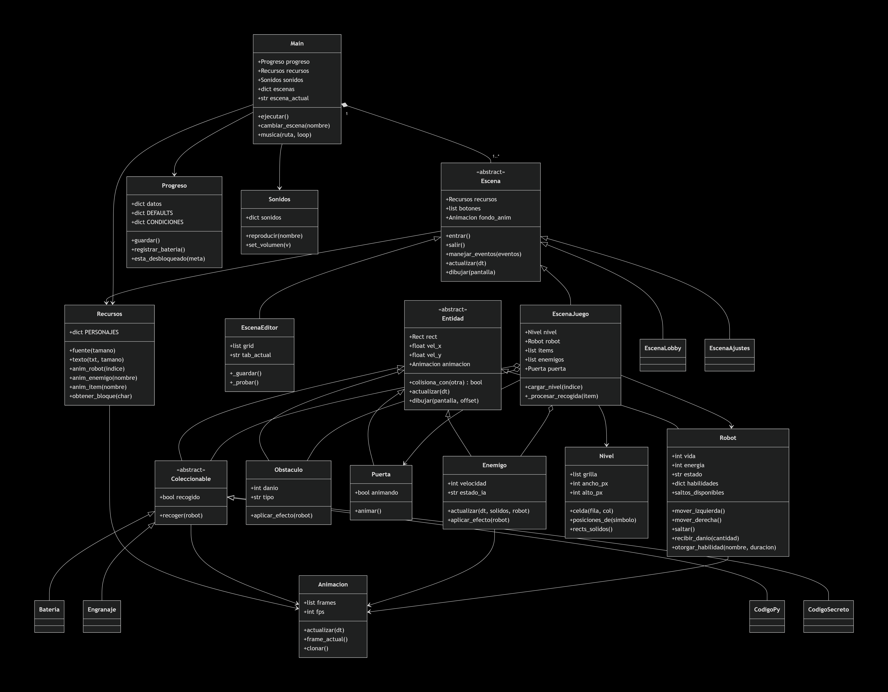
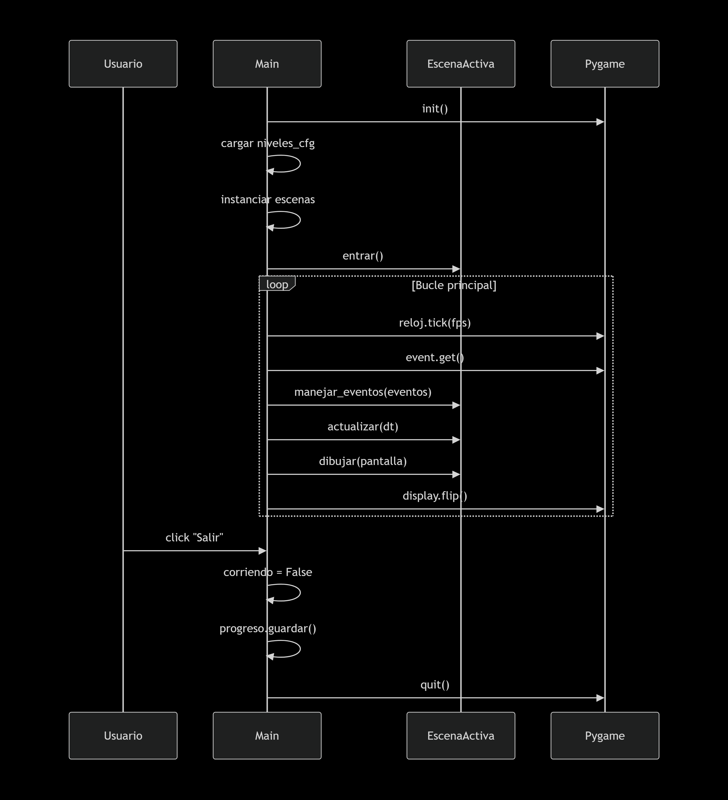
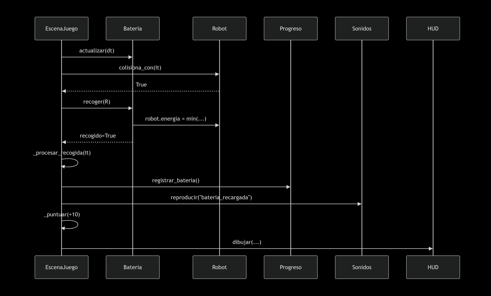
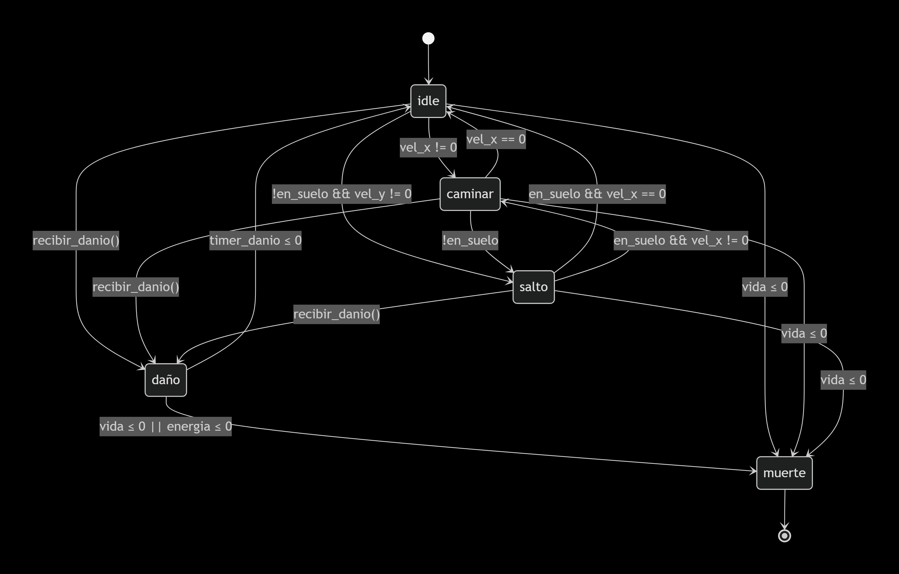

# Corre Robot, Corre! — README Técnico

> Documento de análisis del sistema: arquitectura, Programación Orientada a Objetos (POO), diagramas UML y propuesta de Test-Driven Development (TDD) para el proyecto **Corre Robot, Corre!**, desarrollado como trabajo del curso *Paradigmas de Programación* en la **Fundación de Educación Superior Nueva América**.

---

## Índice

1. [Descripción general](#-descripcion)
2. [Características del juego](#-caracteristicas)
3. [Requisitos e instalación](#-requisitos)
4. [Estructura del proyecto](#-estructura)
5. [Arquitectura del sistema](#-arquitectura)
6. [Análisis POO](#-analisis-POO)
7. [Diagramas UML](#-uml)
8. [Controles](#-controles)

---
<a id="descripcion"></a>
## Descripción general

**Corre Robot, Corre!** es un videojuego de plataformas 2D con scroll horizontal, escrito en **Python 3** y **pygame**. El jugador controla un robot que debe atravesar niveles basados en cuadrículas (tiles de 40×40 px), recoger ítems (baterías, engranajes, fragmentos de código), esquivar pinchos y enemigos, y llegar a la puerta de salida antes de que su energía o su vida lleguen a cero.

El proyecto incluye:

- Un **motor de escenas** con transiciones y estados.
- Un **editor de niveles** integrado.
- Un sistema de **personajes desbloqueables**.
- **Persistencia JSON** de progreso, ajustes y niveles creados por el usuario.
- Sistema de **habilidades temporales** (doble salto, súper salto, vuelo, etc.).
- **Fragmentos secretos** que juntos forman un código desbloqueable.

---
<a id="caracteristicas"></a>
## Características del juego

| Módulo | Descripción |
|---|---|
| **Lobby** | Pantalla principal con botones vectoriales/sprites animados. |
| **Selector de niveles** | Carga niveles desde `levels/niveles.json`. |
| **Editor de niveles** | Herramientas *BUILD / EDIT / DELETE*, zoom, swipe, borrador, paleta de bloques. |
| **Selector de personajes** | 5 personajes con requisitos de desbloqueo. |
| **Juego** | Física, cámara, HUD, ítems, enemigos, puerta final. |
| **Ajustes** | Volumen, FPS, calidad, pantalla completa, remapeo de teclas. |
| **Persistencia** | `progreso.json` con estadísticas acumuladas. |
| **Música y SFX** | Cargados desde `assets/sonidos/`. |
| **Mis niveles** | Listado, renombrado, edición y borrado de niveles de usuario. |

---
<a id="requisitos"></a>
## Requisitos e instalación

### Requisitos
- **Python ≥ 3.9**
- **pygame ≥ 2.5**

### Instalación
```bash
git clone https://github.com/joelXVS/Corre-Robot--Corre-.git
cd Corre-Robot--Corre-
python -m pip install pygame
python main.py
```

### Estructura de assets
```text
assets/
├── MinecraftStandard.otf
├── sonidos/ # .wav, .ogg, .mp3
├── spritesheets/ # personajes, bloques, enemigos, ítems, UI
├── fondos/
└── suelos/ # No disponible
levels/
├── niveles.json
├── level1.txt
└── usuario/ # niveles creados por el jugador
```

<a id="estructura"></a>
## Estructura del proyecto

```text
proyecto/
├── main.py                 # Motor de la aplicación
├── ajustes.py              # Constantes globales
├── progreso.py             # Persistencia JSON
├── progreso.json           # Datos del jugador
├── recursos.py             # Gestor de assets
├── sound.py                # Gestor de sonidos
├── animator.py             # Animación por secuencia
├── spritesheet.py          # División de spritesheets
├── level.py                # Parser de niveles .txt
├── button.py               # Botón simple
├── hud.py                  # Heads-Up Display
├── icon_button.py          # Botón con icono/spritesheet
├── selector.py             # Selector horizontal
├── slider.py               # Slider
├── toggle.py               # Toggle
├── scenes/
│   ├── scene.py
│   ├── lobby.py
│   ├── level_selector.py
│   ├── settings.py
│   ├── credits.py
│   ├── character_selector.py
│   ├── juego.py
│   ├── victory.py
│   ├── defeat.py
│   ├── loading.py
│   ├── my_levels.py
│   ├── editor.py
│   └── how_to_play.py
├── entities/
│   ├── entity.py
│   ├── robot.py
│   ├── enemy.py
│   ├── obstacle.py
│   ├── door.py
│   └── items.py
└── levels/
    ├── niveles.json
    └── usuario/
```

<a id="arquitectura"></a>
## Arquitectura del Sistema

El sistema sigue una arquitectura en capas con separación clara de responsabilidades:

```text
┌──────────────────────────────────────────────────┐
│  CAPA DE APLICACIÓN (main.py)                    │
│  · Ciclo principal, manejo de escenas, reloj     │
└────────────────────┬─────────────────────────────┘
                     │ delega
┌────────────────────▼─────────────────────────────┐
│  CAPA DE ESCENAS (scenes/*.py)                   │
│  · Cada escena: entrar/salir/eventos/update/draw │
└────────────────────┬─────────────────────────────┘
                     │ usa
┌────────────────────▼─────────────────────────────┐
│  CAPA DE DOMINIO (entities/*, level.py)          │
│  · Robot, Enemigos, Ítems, Puerta, Nivel         │
└────────────────────┬─────────────────────────────┘
                     │ depende de
┌────────────────────▼─────────────────────────────┐
│  CAPA DE INFRAESTRUCTURA (recursos, sound,       │
│  progreso, animator, spritesheet)                │
└──────────────────────────────────────────────────┘
```

- Main orquesta escenas y mantiene el estado global de la aplicación.

- Las escenas son objetos polimórficos que implementan un contrato fijo.

- Las entidades encapsulan la lógica de dominio.

- Los gestores (Recursos, Sonidos, Progreso) actúan como servicios transversales con caches.

---
<a id="analisis-POO"></a>
## Análisis POO

### 1. Herencia
#### Jerarquía de entidades

```text
pygame.sprite.Sprite
    └── Entidad                       (entities/entity.py)
            ├── Robot                 (entities/robot.py)
            ├── Enemigo               (entities/enemy.py)
            ├── Obstaculo             (entities/obstacle.py)
            ├── Puerta                (entities/door.py)
            └── Coleccionable         (entities/items.py)
                    ├── Bateria
                    ├── Engranaje
                    ├── CodigoPy
                    └── CodigoSecreto
```

#### Jerarquía de escenas

```text
Escena                                (scenes/scene.py)
    ├── EscenaLobby
    ├── EscenaNiveles
    ├── EscenaAjustes
    ├── EscenaCreditos
    ├── EscenaPersonajes
    ├── EscenaJuego
    ├── EscenaVictoria
    ├── EscenaDerrota
    ├── EscenaCargando
    ├── EscenaMisNiveles
    ├── EscenaEditor
    └── EscenaComoJugar
```

### 2. Encapsulamiento
El ejemplo más claro es Progreso, que encapsula self.datos y expone propiedades con validación y persistencia automática:

```python
@property
def vol_musica(self):
    return self.datos["vol_musica"]

@vol_musica.setter
def vol_musica(self, v):
    self.datos["vol_musica"] = float(v)
    self.guardar()          # persistencia automática
```

### 3. Polimorfismo
a) Sobrescritura (recoger)

```python
class Coleccionable(Entidad):
    def recoger(self, robot):
        raise NotImplementedError

class Bateria(Coleccionable):
    def recoger(self, robot):
        robot.energia = min(robot.energia + self.valor, robot.energia_max)

class Engranaje(Coleccionable):
    def recoger(self, robot):
        robot.vida = min(robot.vida + self.valor, robot.vida_max)

class CodigoPy(Coleccionable):
    def recoger(self, robot):
        robot.otorgar_habilidad(self.habilidad, DURACION_HABILIDAD)
```

b) Polimorfismo de escenas — Main.ejecutar() invoca métodos sobre la escena activa sin conocer su tipo.

c) Polimorfismo de botones — Boton y BotonIcono con firmas compatibles.

d) Polimorfismo de condiciones de desbloqueo

```python
CONDICIONES = {
    "Atlas":    lambda s: True,
    "MIO":      lambda s: s["total_completados"] >= 5,
    "Nyx":      lambda s: s["total_completados"] >= 15,
    "Vega":     lambda s: (s["baterias_recogidas"] + s["engranajes_recogidos"]) >= 1000,
    "Xperia51": lambda s: s["codigo_secreto_encontrado"],
}
```

### 4. Abstracción
- Entidad — contrato común (rect, colisiona_con, actualizar, dibujar).

- Coleccionable — recoger lanza NotImplementedError.

- Escena — contrato del ciclo de vida (entrar/salir/manejar_eventos/actualizar/dibujar).

- Nivel — abstrae el formato .txt del resto del juego.

- Recursos — abstrae el acceso a assets con fallbacks.

---
<a id="uml"></a>
## Diagramas UML
### Diagrama de Clases
<>
### Diagrama de Casos de Uso
<>
### Diagrama de secuencia (ciclo principal)
<>
### Diagrama de secuencia (recoger batería)
<>
### Diagrama de Estados
<>

---
<a id="controles"></a>
## Controles
| Acción | Tecla por defecto |
|---|---|
| Mover izquierda |	←
| Mover derecha	| →
| Saltar | Espacio
| Pausa | Esc |
| Reiniciar nivel | R |

Todos los controles son remapeables desde Ajustes → Cómo jugar.
